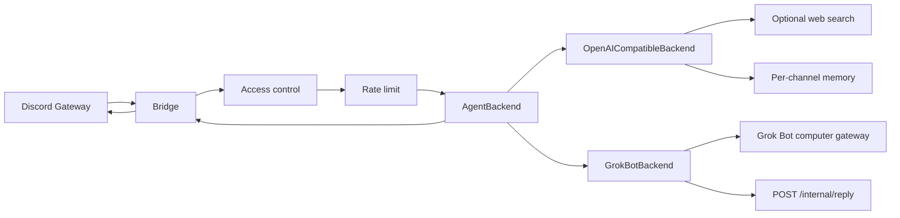

# discord-agent-bridge

Open-source **Discord ↔ Grok Bot connector** for anyone who uses Discord (instead of Slack/Teams) to talk to and work with Grok Bots — individuals and small teams.

The bridge handles Discord auth, routing, and reply UX. **Persona, tools, and routines live in the Grok Bot** (or in your `SYSTEM_PROMPT_FILE`), not in this repo. A team assistant or a gaming helper are examples; this project stays general.



### North Star vs Phase 1

| | |
|--|--|
| **North Star** | Official Grok Bot Discord/Channels inbound API — this repo stays the community connector for that. |
| **Phase 1 (today)** | `OpenAICompatibleBackend` is the default production path (xAI / OpenAI / OpenRouter). |
| **Interim grok-bot** | `GrokBotBackend` can wake a Grok Bot agent via that computer's private HTTP gateway (`POST /api/sendPrompt`) and receive the answer on an authenticated `POST /internal/reply`. Unofficial; may break. |

## Requirements

- Node.js **20+**
- A Discord bot with **Message Content Intent** enabled
- An OpenAI-compatible API key for the default backend (xAI, OpenAI, OpenRouter, etc.), **or** Grok Bot computer-gateway settings when `AGENT_BACKEND=grok-bot`

## Discord Developer Portal setup

1. [Discord Developer Portal](https://discord.com/developers/applications) → New Application → **Bot**.
2. Copy the bot token → `DISCORD_BOT_TOKEN` (never commit it).
3. Under **Privileged Gateway Intents**, enable **Message Content Intent**.
4. OAuth2 → URL Generator → scopes: `bot`.  
   Permissions: View Channels, Send Messages, Read Message History.
5. Invite to a **private** test server (or enable DMs — see env below). Keep the bot **private** until allowlists are verified.

## Quick start

```bash
cp .env.example .env
# edit .env: DISCORD_BOT_TOKEN, API_*, allowlists

npm install
npm test
npm run build
npm start
# or: npm run dev
```

Optional personas (copy or point `SYSTEM_PROMPT_FILE` at them):

- [`examples/team-assistant/SOUL.md`](examples/team-assistant/SOUL.md) — small-team Discord assistant
- [`examples/gaming-helper/SOUL.md`](examples/gaming-helper/SOUL.md) — domain example only

Docker (OpenAI-compatible path, or a **split-machine** grok-bot bridge — not the colocated localhost topology):

```bash
cp .env.example .env   # fill in secrets
docker compose up --build
```

`docker compose` + `127.0.0.1` does **not** work for grok-bot on the Grok Bot computer. Inside the container, `127.0.0.1:1340` is the container, not the host gateway, and `BRIDGE_HTTP_HOST=127.0.0.1` makes Compose's published callback port unreachable. See [Run the bridge on the Grok Bot computer](#run-the-bridge-on-the-grok-bot-computer).

## Environment variables

| Variable | Required | Description |
|----------|----------|-------------|
| `DISCORD_BOT_TOKEN` | yes | Bot token |
| `DISCORD_ALLOW_ALL_USERS` | no | Default `false`. If `true`, skip user/role allowlists |
| `DISCORD_ALLOWED_USERS` | no | Comma-separated user IDs |
| `DISCORD_ALLOWED_ROLES` | no | Comma-separated role IDs; empty = no role gate |
| `DISCORD_ALLOWED_GUILDS` | no | Comma-separated guild IDs; empty = any guild |
| `DISCORD_ALLOW_DMS` | no | Default `false`. Allow DM conversations with the bot |
| `DISCORD_DM_ONLY` | no | Default `false`. Ignore all guild messages |
| `DISCORD_FREE_RESPONSE_CHANNELS` | no | Channel IDs where @mention is not required. Also the channels autofetch polls |
| `DISCORD_BLOCKED_CHANNELS` | no | Channel IDs the bot never reads, including threads under them |
| `DISCORD_ALLOWED_CHANNELS` | no | If set, guild messages are allowed only in these channels or their threads |
| `DISCORD_REQUIRE_MENTION` | no | Default `true` outside free-response channels (DMs never require mention) |
| `DISCORD_ALLOWED_BOTS` | no | Bot user IDs that may message this bot. Every other bot is ignored |
| `DISCORD_MAX_BOT_TURNS` | no | Default `2`. Cap on unaddressed bot-to-bot replies. An @mention bypasses the cap |
| `DISCORD_INCLUDE_REPLY_CONTEXT` | no | Default `false`. Include the message being replied to in the agent prompt |
| `DISCORD_AUTOFETCH` | no | Default `false`. Poll free-response channels for messages the gateway missed |
| `DISCORD_AUTOFETCH_INTERVAL_MS` | no | Default `15000`, minimum `5000` |
| `DISCORD_AUTOFETCH_LOOKBACK_MS` | no | Default `7200000` (2 hours). Older messages are not delivered |
| `DISCORD_AUTOFETCH_STATE_DIR` | no | Default `run`. Directory for `autofetch-state.<botUserId>.json` |
| `DISCORD_AUTOFETCH_FETCH_TIMEOUT_MS` | no | Default `10000` (min `1000`, max `60000`) per Discord REST call |
| `DISCORD_AUTOFETCH_FETCH_ATTEMPTS` | no | Default `3` (min `1`, max `5`) attempts for transient DNS/connect errors. A 429 waits for `retry_after` (capped at 60s) |
| `DISCORD_AUTOFETCH_BACKFILL` | no | Default `false`. With no saved cursor, seed to the newest message and deliver nothing. `true` replays the lookback once. A corrupt state file always seeds and does not replay |
| `DISCORD_HEARTBEAT_EVERY` | no | Default `20`. Log clean autofetch heartbeats every N ticks, and always when the outcome changes. Skipped and error ticks always log |
| `DISCORD_HOME_CHANNEL` | no | Optional home channel (logged at startup) |
| `AGENT_BACKEND` | no | `openai` (default) or `grok-bot` |
| `API_BASE_URL` | if openai | e.g. `https://api.x.ai/v1` or `https://api.openai.com/v1` |
| `API_KEY` | if openai | Provider API key |
| `MODEL` | if openai | Model id |
| `GROK_BOT_GATEWAY_URL` | if grok-bot | Private computer gateway base. Colocated host process: `http://127.0.0.1:1340`. Split-machine: a private host URL. |
| `GROK_BOT_TOKEN` | if grok-bot | Bearer token from that computer's `gateway.json` (password) |
| `GROK_BOT_AGENT_ID` | if grok-bot | Target agent id from `POST /api/listAgents` (from env, not hardcoded) |
| `GROK_BOT_TIMEOUT_MS` | no | Default `120000` — how long `generate()` waits for `/internal/reply` |
| `BRIDGE_HTTP_HOST` | no | Default `0.0.0.0`. Colocated host process: bind `127.0.0.1` so the callback is localhost-only. |
| `BRIDGE_HTTP_PORT` | no | Default `8788`. Compose maps host and container to this port (`${BRIDGE_HTTP_PORT:-8788}:${BRIDGE_HTTP_PORT:-8788}`) |
| `BRIDGE_PUBLIC_URL` | if grok-bot | URL the **Grok Bot computer** uses to reach this bridge. Colocated host process: `http://127.0.0.1:8788`. When the bridge runs on a different machine, that machine's `localhost` is not the bridge. |
| `BRIDGE_REPLY_TOKEN` | if grok-bot | Shared secret for `Authorization: Bearer` on `POST /internal/reply` (password) |
| `SYSTEM_PROMPT_FILE` | no | Default `SOUL.md` (neutral); swap for your agent persona |
| `TEMPERATURE` | no | Default `0.7` |
| `MAX_TOKENS` | no | Default `1024` |
| `MEMORY_MAX_MESSAGES` | no | Default `20` (per channel/thread key) |
| `RATE_LIMIT_PER_USER` | no | Default `5` / window |
| `RATE_LIMIT_WINDOW_MS` | no | Default `60000` |
| `BRAVE_API_KEY` | no | Enables Brave web search tool |
| `TAVILY_API_KEY` | no | Enables Tavily web search tool |

Access control fails closed: if `DISCORD_ALLOW_ALL_USERS` is false and both user/role allowlists are empty, nobody is served.

When `DISCORD_AUTOFETCH=true`, the bridge polls free-response channels and stores the last handed-off message id per channel under `DISCORD_AUTOFETCH_STATE_DIR` (one file per bot user id). Delivery is at-most-once: the cursor advances when the message is handed to the handler, before the agent reply finishes. The first poll with no cursor seeds that cursor to the newest id and delivers nothing unless `DISCORD_AUTOFETCH_BACKFILL=true`. A corrupt state file always seeds and does not replay, even when backfill is on. A full page of 25 messages that still starts after the cursor logs a gap warning; those in-between messages were not fetched.

Clean ticks log `[bridge] heartbeat tick=N ok ...` on the first tick, every `DISCORD_HEARTBEAT_EVERY` ticks, and whenever the outcome changes. `[bridge] heartbeat tick=N skipped: ...` and `heartbeat tick=N error ...` always log. Transient DNS/connect/429 errors stay in-process. The process exits `75` only when an in-flight fetch or retry sleep makes no progress past its own timeout; a slow outage does not. discord.js 14 channel and message fetch methods do not accept an AbortSignal, so a timed-out poll stops waiting but cannot cancel the underlying REST socket.

`AGENT_BACKEND=grok-bot` also fails closed if any of `GROK_BOT_GATEWAY_URL`, `GROK_BOT_TOKEN`, `GROK_BOT_AGENT_ID`, `BRIDGE_PUBLIC_URL`, or `BRIDGE_REPLY_TOKEN` is missing.

Web search tools are registered **only** when at least one of `BRAVE_API_KEY` / `TAVILY_API_KEY` is set (Phase 1 OpenAI-compatible path).

### Grok Bot callback (interim)

There is no official Discord plugin. The working community path is:

1. Bridge `POST`s `{ agentId, prompt }` to `GROK_BOT_GATEWAY_URL/api/sendPrompt` (wakes the agent; does **not** return the reply).
2. The prompt includes a machine-readable block: `correlationId`, `replyUrl` (`BRIDGE_PUBLIC_URL/internal/reply`), and how to send `Authorization: Bearer <BRIDGE_REPLY_TOKEN>`.
3. The Grok Bot agent `POST`s `{ correlationId, text }` back to the bridge.
4. The bridge posts `text` to the matching Discord channel/thread (same ~1900 split as the OpenAI path).

`BRIDGE_PUBLIC_URL` must be reachable **from the Grok Bot computer**.

- **Colocated host process (works today):** `npm start` on the Grok Bot computer (not Docker) and use `http://127.0.0.1:8788`. See [Run the bridge on the Grok Bot computer](#run-the-bridge-on-the-grok-bot-computer).
- **Split-machine:** when the bridge runs on a different machine (for example Docker on a laptop), `localhost` on the Grok Bot computer is not the bridge. Use Tailscale, an SSH tunnel, or another private path.

**Do not** expose the Grok Bot gateway port (`:1340`) or the callback port (`:8788`) to the internet. Keep `DISCORD_BOT_TOKEN` in the bridge's local `.env` only — never in the Grok Bot agent, `gateway.json`, or git. Treat `GROK_BOT_TOKEN` and `BRIDGE_REPLY_TOKEN` like passwords; never commit or log them.

This callback is unofficial and may break. See [docs/PHASE2-GROK-BOT-BACKEND.md](docs/PHASE2-GROK-BOT-BACKEND.md).

## Run the bridge on the Grok Bot computer

The setup that works today without Tailscale or a tunnel is a **host-process-only** topology: run `npm start` **on the Grok Bot computer itself** (same network namespace as the gateway). Both the gateway (`:1340`) and the callback (`:8788`) stay on that host's localhost.

This is **not** `docker compose` on that computer. Inside a container, `127.0.0.1:1340` is the container, not the host gateway, and `BRIDGE_HTTP_HOST=127.0.0.1` binds the callback to the container loopback so Compose's published port cannot reach it.

**Prerequisites**

- Node.js **20+** on the Grok Bot computer (host process, not a container)
- Discord bot token in a local `.env` only (never commit it)
- Grok Bot computer gateway listening on `127.0.0.1:1340`

**Configure**

```bash
cp .env.example .env
```

Set `AGENT_BACKEND=grok-bot` and these localhost URLs (do not publish them):

```
GROK_BOT_GATEWAY_URL=http://127.0.0.1:1340
BRIDGE_PUBLIC_URL=http://127.0.0.1:8788
BRIDGE_HTTP_HOST=127.0.0.1
```

Then fill in:

- `GROK_BOT_TOKEN` — bearer from that computer's `gateway.json` (treat like a password). Grok Bot computers commonly store this at `/home/box/sand-data/gateway.json`; use whatever path that computer actually uses.
- `GROK_BOT_AGENT_ID` — from `POST /api/listAgents` on the gateway. Do not hardcode a real id in this repo.
- `BRIDGE_REPLY_TOKEN` — generate a random secret (`openssl rand -hex 32` or equivalent). Do not commit it.
- Discord allowlists (`DISCORD_ALLOWED_USERS` / roles / guilds, or DMs). Keep the Discord application **private**.

**Run**

```bash
npm ci
npm run build
npm start
```

Optional crash-only wrapper (restarts `npm start` if the Node process exits while this shell stays alive):

```bash
while true; do npm start; echo "bridge exited; restarting in 5s"; sleep 5; done
```

A Grok Bot computer **Update** keeps files on disk but stops running processes, including this shell. The loop does **not** survive an Update. After an Update, something **outside** that shell must start the bridge again: a manual `npm start`, a Grok Bot routine that checks and relaunches, or another supervisor that is re-armed after the update.

Docker on the same Grok Bot host is a **different** setup, not this topology. The container must reach the host gateway (for example `host.docker.internal` / `extra_hosts`), and you must **not** bind the callback to the container's `127.0.0.1` if you need Compose's published port. Prefer the host-process path above.

In this host-process mode, **never** expose `:1340` or `:8788` beyond localhost. Full topology notes (colocated host process vs split-machine + Tailscale/tunnel) are in [docs/PHASE2-GROK-BOT-BACKEND.md](docs/PHASE2-GROK-BOT-BACKEND.md).

## Scripts

| Script | Action |
|--------|--------|
| `npm run dev` | Run with `tsx watch` |
| `npm start` | Run compiled `dist/index.js` |
| `npm test` | Vitest |
| `npm run build` | `tsc` → `dist/` |

## Security

- **Never commit** `.env`, tokens, or API keys. `.gitignore` excludes `.env` and `*.log`.
- Treat `GROK_BOT_TOKEN` and `BRIDGE_REPLY_TOKEN` like passwords. Do not log them.
- `POST /internal/reply` is authenticated and fail-closed (missing/wrong token → 401). It is not a public webhook.
- In colocated mode, bind the callback to `127.0.0.1` and do not expose `:1340` or `:8788` beyond localhost.
- Keep the Discord application **private** until you trust your allowlists.
- Prefer a private server (or DM-only personal use) for the first run.
- The bot ignores other bots and itself; replies are split near 1900 characters.

## Migrating from another Discord agent host

1. Map allowlists → `DISCORD_ALLOWED_USERS` / `DISCORD_ALLOWED_ROLES` / `DISCORD_ALLOWED_GUILDS` / `DISCORD_FREE_RESPONSE_CHANNELS`.
2. Point `SYSTEM_PROMPT_FILE` at your soul/instructions (or copy into `SOUL.md`). Keep proprietary host code out of this repo.
3. Use `AGENT_BACKEND=openai` (default) or `AGENT_BACKEND=grok-bot` with the private computer gateway + callback (see above).
4. Run as an always-on process (`npm start` or Docker); smoke-test in `DISCORD_HOME_CHANNEL` or a DM.

See [docs/PLAN.md](docs/PLAN.md) and [docs/PHASE2-GROK-BOT-BACKEND.md](docs/PHASE2-GROK-BOT-BACKEND.md).

## License

MIT — see [LICENSE](LICENSE).
