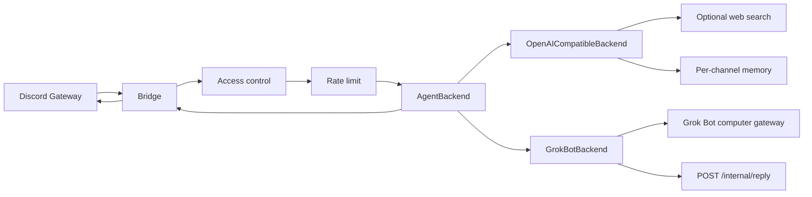

# discord-agent-bridge

Open-source **Discord ↔ Grok Bot connector** for anyone who uses Discord (instead of Slack/Teams) to talk to and work with Grok Bots — individuals and small teams.

The bridge handles Discord auth, routing, and reply UX. **Persona, tools, and routines live in the Grok Bot** (or in your `SYSTEM_PROMPT_FILE`), not in this repo. A team assistant or a gaming helper are examples; this project stays general.



### North Star vs Phase 1

| | |
|--|--|
| **North Star** | Official Grok Bot Discord/Channels inbound API — this repo stays the community connector for that. |
| **Phase 1 (today)** | `OpenAICompatibleBackend` is the default production path (xAI / OpenAI / OpenRouter). |
| **Interim grok-bot** | `GrokBotBackend` can wake a Grok Bot agent via that computer's private HTTP gateway (`POST /api/sendPrompt`) and receive the answer on an authenticated `POST /internal/reply`. Unofficial; may break. |

## Requirements

- Node.js **20+**
- A Discord bot with **Message Content Intent** enabled
- An OpenAI-compatible API key for the default backend (xAI, OpenAI, OpenRouter, etc.), **or** Grok Bot computer-gateway settings when `AGENT_BACKEND=grok-bot`

## Discord Developer Portal setup

1. [Discord Developer Portal](https://discord.com/developers/applications) → New Application → **Bot**.
2. Copy the bot token → `DISCORD_BOT_TOKEN` (never commit it).
3. Under **Privileged Gateway Intents**, enable **Message Content Intent**.
4. OAuth2 → URL Generator → scopes: `bot`.  
   Permissions: View Channels, Send Messages, Read Message History.
5. Invite to a **private** test server (or enable DMs — see env below). Keep the bot **private** until allowlists are verified.

## Quick start

```bash
cp .env.example .env
# edit .env: DISCORD_BOT_TOKEN, API_*, allowlists

npm install
npm test
npm run build
npm start
# or: npm run dev
```

Optional personas (copy or point `SYSTEM_PROMPT_FILE` at them):

- [`examples/team-assistant/SOUL.md`](examples/team-assistant/SOUL.md) — small-team Discord assistant
- [`examples/gaming-helper/SOUL.md`](examples/gaming-helper/SOUL.md) — domain example only

Docker:

```bash
cp .env.example .env   # fill in secrets
docker compose up --build
```

## Environment variables

| Variable | Required | Description |
|----------|----------|-------------|
| `DISCORD_BOT_TOKEN` | yes | Bot token |
| `DISCORD_ALLOW_ALL_USERS` | no | Default `false`. If `true`, skip user/role allowlists |
| `DISCORD_ALLOWED_USERS` | no | Comma-separated user IDs |
| `DISCORD_ALLOWED_ROLES` | no | Comma-separated role IDs; empty = no role gate |
| `DISCORD_ALLOWED_GUILDS` | no | Comma-separated guild IDs; empty = any guild |
| `DISCORD_ALLOW_DMS` | no | Default `false`. Allow DM conversations with the bot |
| `DISCORD_DM_ONLY` | no | Default `false`. Ignore all guild messages |
| `DISCORD_FREE_RESPONSE_CHANNELS` | no | Channel IDs where @mention is not required |
| `DISCORD_REQUIRE_MENTION` | no | Default `true` outside free-response channels (DMs never require mention) |
| `DISCORD_HOME_CHANNEL` | no | Optional home channel (logged at startup) |
| `AGENT_BACKEND` | no | `openai` (default) or `grok-bot` |
| `API_BASE_URL` | if openai | e.g. `https://api.x.ai/v1` or `https://api.openai.com/v1` |
| `API_KEY` | if openai | Provider API key |
| `MODEL` | if openai | Model id |
| `GROK_BOT_GATEWAY_URL` | if grok-bot | Private computer gateway base, e.g. `http://host:1340` |
| `GROK_BOT_TOKEN` | if grok-bot | Bearer token from that computer's `gateway.json` (password) |
| `GROK_BOT_AGENT_ID` | if grok-bot | Target agent id (from env, not hardcoded) |
| `GROK_BOT_TIMEOUT_MS` | no | Default `120000` — how long `generate()` waits for `/internal/reply` |
| `BRIDGE_HTTP_HOST` | no | Default `0.0.0.0` — listen address for the callback server |
| `BRIDGE_HTTP_PORT` | no | Default `8788` — published by Docker Compose |
| `BRIDGE_PUBLIC_URL` | if grok-bot | URL the **Grok Bot computer** uses to reach this bridge (not `localhost` on that machine) |
| `BRIDGE_REPLY_TOKEN` | if grok-bot | Shared secret for `Authorization: Bearer` on `POST /internal/reply` (password) |
| `SYSTEM_PROMPT_FILE` | no | Default `SOUL.md` (neutral); swap for your agent persona |
| `TEMPERATURE` | no | Default `0.7` |
| `MAX_TOKENS` | no | Default `1024` |
| `MEMORY_MAX_MESSAGES` | no | Default `20` (per channel/thread key) |
| `RATE_LIMIT_PER_USER` | no | Default `5` / window |
| `RATE_LIMIT_WINDOW_MS` | no | Default `60000` |
| `BRAVE_API_KEY` | no | Enables Brave web search tool |
| `TAVILY_API_KEY` | no | Enables Tavily web search tool |

Access control fails closed: if `DISCORD_ALLOW_ALL_USERS` is false and both user/role allowlists are empty, nobody is served.

`AGENT_BACKEND=grok-bot` also fails closed if any of `GROK_BOT_GATEWAY_URL`, `GROK_BOT_TOKEN`, `GROK_BOT_AGENT_ID`, `BRIDGE_PUBLIC_URL`, or `BRIDGE_REPLY_TOKEN` is missing.

Web search tools are registered **only** when at least one of `BRAVE_API_KEY` / `TAVILY_API_KEY` is set (Phase 1 OpenAI-compatible path).

### Grok Bot callback (interim)

There is no official Discord plugin. The working community path is:

1. Bridge `POST`s `{ agentId, prompt }` to `GROK_BOT_GATEWAY_URL/api/sendPrompt` (wakes the agent; does **not** return the reply).
2. The prompt includes a machine-readable block: `correlationId`, `replyUrl` (`BRIDGE_PUBLIC_URL/internal/reply`), and how to send `Authorization: Bearer <BRIDGE_REPLY_TOKEN>`.
3. The Grok Bot agent `POST`s `{ correlationId, text }` back to the bridge.
4. The bridge posts `text` to the matching Discord channel/thread (same ~1900 split as the OpenAI path).

`BRIDGE_PUBLIC_URL` must be reachable **from the Grok Bot computer**. The bridge often runs in Docker on a different machine than the Grok Bot computer, so `localhost` on the Grok Bot side is not the bridge. Use Tailscale, an SSH tunnel, or another private path.

**Do not** expose the Grok Bot gateway port (`:1340`) to the internet. **Do not** put `DISCORD_BOT_TOKEN` on the Grok Bot side. Treat `GROK_BOT_TOKEN` and `BRIDGE_REPLY_TOKEN` like passwords; never commit or log them.

This callback is unofficial and may break. See [docs/PHASE2-GROK-BOT-BACKEND.md](docs/PHASE2-GROK-BOT-BACKEND.md).

## Scripts

| Script | Action |
|--------|--------|
| `npm run dev` | Run with `tsx watch` |
| `npm start` | Run compiled `dist/index.js` |
| `npm test` | Vitest |
| `npm run build` | `tsc` → `dist/` |

## Security

- **Never commit** `.env`, tokens, or API keys. `.gitignore` excludes `.env`.
- Treat `GROK_BOT_TOKEN` and `BRIDGE_REPLY_TOKEN` like passwords. Do not log them.
- `POST /internal/reply` is authenticated and fail-closed (missing/wrong token → 401). It is not a public webhook.
- Keep the Discord application **private** until you trust your allowlists.
- Prefer a private server (or DM-only personal use) for the first run.
- The bot ignores other bots and itself; replies are split near 1900 characters.

## Migrating from another Discord agent host

1. Map allowlists → `DISCORD_ALLOWED_USERS` / `DISCORD_ALLOWED_ROLES` / `DISCORD_ALLOWED_GUILDS` / `DISCORD_FREE_RESPONSE_CHANNELS`.
2. Point `SYSTEM_PROMPT_FILE` at your soul/instructions (or copy into `SOUL.md`). Keep proprietary host code out of this repo.
3. Use `AGENT_BACKEND=openai` (default) or `AGENT_BACKEND=grok-bot` with the private computer gateway + callback (see above).
4. Run as an always-on process (`npm start` or Docker); smoke-test in `DISCORD_HOME_CHANNEL` or a DM.

See [docs/PLAN.md](docs/PLAN.md) and [docs/PHASE2-GROK-BOT-BACKEND.md](docs/PHASE2-GROK-BOT-BACKEND.md).

## License

MIT — see [LICENSE](LICENSE).
