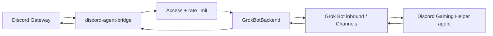

# Phase 2 spike — real `GrokBotBackend` cutover

Date: 2026-08-12  
Status: **blocked on product** — no first-party Discord / Channels inbound API yet  
Repo role: keep Discord UX + access control; persona/tools live in a Grok Bot agent

## What we have today (Phase 1)

| Piece | State |
|-------|--------|
| Discord gateway (`discord.js`) | Live as HermesHelper |
| `OpenAICompatibleBackend` | Production path (OpenRouter `x-ai/grok-4.6`) |
| `GrokBotBackend` | Stub that throws (intentional) |
| Access / rate limit / split / thread memory / channel context | Done |
| Grok Bot agent `Discord Gaming Helper` | Exists with full gaming persona — **not wired to Discord** |
| Grok Bot Channels UI | Per-agent pane supports Channels (e.g. GitHub on CoS); **no Discord connector in marketplace** |

## Finding (2026-08-12)

1. Cursor / Grok Bot plugin catalog has **Slack** and other connectors; **no Discord** plugin/connector.
2. Grok Bot launch materials describe bots, computers, Slack/Teams-style team chat — not a documented public HTTP “inbound message” API for Discord.
3. Inventing a private API against the app would violate this repo’s Phase 1 rule (“do not invent the Grok Bot API”).
4. Therefore **North Star cutover is not implementable yet**. Phase 1 OpenAI-compatible remains the correct production backend.

## Target architecture (when Channels Discord or inbound API lands)



Bridge keeps: Discord auth, allowlists, free-response, typing, split replies, conversation keys.  
Agent owns: soul, tools, memory beyond ephemeral bridge buffer, routines.

## Proposed `GrokBotBackend` contract (freeze this; implement when API exists)

Env (sketch):

| Variable | Purpose |
|----------|---------|
| `AGENT_BACKEND=grok-bot` | Select this backend |
| `GROK_BOT_INBOUND_URL` | Documented HTTPS endpoint |
| `GROK_BOT_API_KEY` / token | Auth for inbound |
| `GROK_BOT_AGENT_ID` | Target agent (e.g. Discord Gaming Helper) |
| `GROK_BOT_TIMEOUT_MS` | Request timeout |

Request body (map from `AgentRequest`):

```json
{
  "agentId": "...",
  "conversationKey": "thread:… or channel:…",
  "authorDisplayName": "…",
  "content": "…",
  "channelName": "7dtd",
  "threadName": "optional",
  "channelTopic": "optional",
  "guildName": "optional",
  "metadata": { "platform": "discord", "source": "discord-agent-bridge" }
}
```

Response:

```json
{ "text": "…" }
```

Errors: map HTTP/timeouts to Discord’s existing “Sorry — I hit an error…” path.  
Do **not** put Discord bot token into Grok Bot; bot token stays on the bridge host.

## Cutover checklist (execute only after API is real)

1. Confirm official docs + auth model (OAuth vs API key vs channel connect card).
2. Implement `src/agent/grokBot.ts` against the documented schema; add vitest with mocked fetch.
3. Wire config validation for grok-bot env vars in `config.ts`.
4. Smoke-test: `#ask-hermes` + `#7dtd` mention → reply from **Discord Gaming Helper** persona/tools (not local SOUL.md).
5. Flip `.env` `AGENT_BACKEND=grok-bot`; keep OpenAI path as fallback.
6. Optionally shrink or remove local `SYSTEM_PROMPT_FILE` dependency for that mode.
7. Update README / PLAN Phase 2 from “stub” to “supported”.

## Interim options (optional; not North Star)

| Option | Pros | Cons |
|--------|------|------|
| **A. Stay on Phase 1** (recommended default) | Already works; low risk | Persona/tools not the full Grok Bot agent |
| **B. Persona sync** — periodically copy Discord Gaming Helper instructions into `SYSTEM_PROMPT_FILE` | Closer voice; still OpenRouter | No agent tools/routines/memory; drift risk |
| **C. Wait for official Discord Channel** — connect in agent info pane when it appears | True North Star; least invention | Unknown ETA |
| **D. Local Cursor-CLI Discord bridges** (e.g. community Cursor↔Discord projects) | Different stack | Not Grok Bot; splits identity |

Recommendation: **A + C**. Keep HermesHelper on OpenRouter. Treat Discord Gaming Helper as the future target agent. Revisit when a Discord Channel connector or inbound API ships.

## Watch list

- Grok Bot / Cursor Plugins marketplace: Discord
- Per-agent Channels UI: Discord connect card
- Forum / docs: “Channels”, “inbound”, “messaging”
- Any official webhook/HTTP agent invoke API

## Decision needed from Nathan

1. Park backend implementation until Discord Channels exists? (**default yes**)
2. Want interim **persona sync** (Option B) so Discord voice matches Discord Gaming Helper sooner?