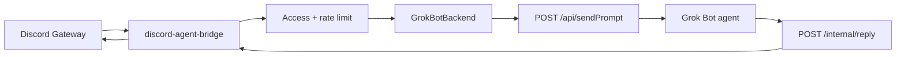

# Phase 2 — `GrokBotBackend` (interim computer-gateway callback)

Date: 2026-08-14  
Status: **interim, unofficial** — no first-party Discord / Channels inbound API  
Repo role: keep Discord UX + access control; persona/tools live in a Grok Bot agent

## What we have today

| Piece | State |
|-------|--------|
| Discord gateway (`discord.js`) | Production |
| `OpenAICompatibleBackend` | **Default production path** (`AGENT_BACKEND=openai`) |
| `GrokBotBackend` | Implemented against the **undocumented-but-real** Grok Bot computer HTTP gateway + a bridge callback |
| Access / rate limit / split / thread memory / channel context | Done |
| `POST /internal/reply` | Authenticated in-process HTTP server on the bridge |

Grok Bot has **no official Discord plugin**. The working community path is a private HTTP gateway on each Grok Bot computer (typically port **1340**, bearer token in that computer's `gateway.json`).

Verified gateway methods (do not invent others):

- `POST /api/listAgents`
- `POST /api/sendPrompt` `{ agentId, prompt }`
- `GET /health`

`sendPrompt` **wakes the agent asynchronously**. It does **not** return the agent's reply. Replies normally go to Grok Bot chat via the agent's `SendMessage`. Discord only receives text the agent `POST`s back to this bridge.

This design is **unofficial and may break** if the computer gateway changes.

## Interim architecture

1. Discord message passes access control.
2. `GrokBotBackend.generate()` creates a `correlationId`, registers a pending waiter, and `POST`s `sendPrompt` to `GROK_BOT_GATEWAY_URL`.
3. The prompt includes a machine-readable `DISCORD_BRIDGE_REPLY` block plus the human Discord message and `AgentRequest` context.
4. The Grok Bot agent `POST`s `{ correlationId, text }` to `BRIDGE_PUBLIC_URL/internal/reply` with `Authorization: Bearer <BRIDGE_REPLY_TOKEN>`.
5. The bridge looks up the pending request, posts `text` to the matching Discord channel/thread (same ~1900 split as existing replies), then resolves `generate()`.
6. If nothing arrives within `GROK_BOT_TIMEOUT_MS` (default 120s), `generate()` fails so Discord is not stuck typing.

## Callback contract

`POST /internal/reply`

| Rule | Behavior |
|------|----------|
| Listen | `BRIDGE_HTTP_HOST` / `BRIDGE_HTTP_PORT` (defaults `0.0.0.0` / `8788`) |
| Auth | `Authorization: Bearer <BRIDGE_REPLY_TOKEN>` — **fail closed** if unset or wrong → 401 |
| Body | `{ "correlationId": string, "text": string }` (`error` optional) |
| Unknown / expired id | 404 |
| Missing fields | 400 |
| Success | 200 `{ "ok": true }` |

This is **not** an unauthenticated public webhook. Do not log `BRIDGE_REPLY_TOKEN` or `GROK_BOT_TOKEN`.

`replyUrl` given to the agent is `BRIDGE_PUBLIC_URL + /internal/reply`. The Grok Bot computer is a **different machine** than the Docker host running the bridge, so `localhost` on the Grok Bot computer is not the bridge. Reachability options: Tailscale, SSH tunnel, or another private path.

**Never** expose the Grok Bot gateway port (`:1340`) to the internet. **Never** put `DISCORD_BOT_TOKEN` on the Grok Bot side.

## Env (grok-bot mode)

| Variable | Required | Purpose |
|----------|----------|---------|
| `AGENT_BACKEND=grok-bot` | yes (to select) | Select this backend |
| `GROK_BOT_GATEWAY_URL` | yes | e.g. `http://host:1340` |
| `GROK_BOT_TOKEN` | yes | Bearer from `gateway.json` |
| `GROK_BOT_AGENT_ID` | yes | Target agent id (from env; do not hardcode a single id) |
| `GROK_BOT_TIMEOUT_MS` | no | Default `120000` |
| `BRIDGE_HTTP_HOST` | no | Default `0.0.0.0` |
| `BRIDGE_HTTP_PORT` | no | Default `8788` (Compose publishes `8788:8788`) |
| `BRIDGE_PUBLIC_URL` | yes | URL the Grok Bot computer uses to reach the bridge |
| `BRIDGE_REPLY_TOKEN` | yes | Shared secret for the callback |

OpenAI-compatible remains the default. grok-bot fails closed if required vars are missing.

## Prompt block (what the agent must parse)

The bridge embeds a JSON block between `---BEGIN DISCORD_BRIDGE_REPLY---` / `---END DISCORD_BRIDGE_REPLY---` containing:

- `correlationId`
- `replyUrl`
- `authorization` (`Bearer <BRIDGE_REPLY_TOKEN>`)
- `httpMethod` / `contentType` / example `body`

Plus Discord context already on `AgentRequest`: `conversationKey`, `channelName`, `threadName`, `channelTopic`, `guildName`, `authorDisplayName`, `content`.

Persona stays in the Grok Bot agent / `SYSTEM_PROMPT_FILE`. This repo is plumbing.

## Errors

Gateway HTTP failures and callback timeouts throw a short Discord-friendly error. The Discord message handler still uses the existing “Sorry — I hit an error generating a reply…” UX and logs the detail (without tokens).

## Official North Star (still blocked)

A documented Discord/Channels inbound API would replace this callback. Until then, do **not** invent a different official API — only `/api/sendPrompt` + this bridge callback.

## Cutover / smoke

1. Set grok-bot env vars; keep `AGENT_BACKEND=openai` as fallback.
2. Confirm `BRIDGE_PUBLIC_URL` is reachable from the Grok Bot computer (`POST /internal/reply` with a wrong token should 401; do not test with real tokens in logs).
3. Mention the bot in Discord → gateway `sendPrompt` → agent callback → Discord reply.
4. If the unofficial gateway changes, park grok-bot mode and stay on OpenAI.

## Watch list

- Official Discord Channel connector / inbound API
- Computer gateway path or auth changes
- Forum / docs: “Channels”, “inbound”, “messaging”
