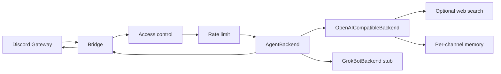

# discord-agent-bridge — Implementation Plan

## Goal

Open-source Discord ↔ AI agent bridge to replace Hermes for a gaming-helper Discord bot.

**Flow:** Discord message → bridge (auth + routing) → pluggable `AgentBackend` → reply in Discord.

## Phase 1 scope (this repo scaffold)

Always-on Node.js gateway bot (not Azure Functions / slash-commands-only). Pluggable backends; production path is OpenAI-compatible HTTP APIs (xAI / OpenAI / OpenRouter). Grok Bot Channels API is an extension stub only.

### Stack

| Piece | Choice |
|-------|--------|
| Runtime | Node.js 20+, TypeScript ESM |
| Discord | discord.js v14 gateway (`GuildMessages` + `MessageContent` intents) |
| Tests | Vitest |
| Build | `tsc` → `dist/` |
| Ops | Dockerfile + docker-compose |
| CI | GitHub Actions: install → test → build |
| License | MIT |

### Architecture

### Modules

| Module | Responsibility |
|--------|----------------|
| `src/config.ts` | Parse/validate env; export typed config |
| `src/discord/access.ts` | Role / user / mention / free-channel gates |
| `src/discord/rateLimit.ts` | Simple per-user sliding window |
| `src/discord/reply.ts` | Typing indicator, ~1900-char split, send |
| `src/discord/bot.ts` | Client, messageCreate handler, ignore bots/self |
| `src/agent/backend.ts` | `AgentBackend` interface |
| `src/agent/openaiCompatible.ts` | Chat completions + memory + optional tools |
| `src/agent/grokBot.ts` | Stub throwing clear not-implemented error |
| `src/agent/memory.ts` | In-memory per-channel/thread history with length cap |
| `src/agent/tools/webSearch.ts` | Brave and/or Tavily if keys present |
| `src/index.ts` | Load config, pick backend, start bot |
| `SOUL.md` | Default system prompt (gaming helper) |

### Env vars

| Variable | Required | Notes |
|----------|----------|-------|
| `DISCORD_BOT_TOKEN` | yes | Bot token |
| `DISCORD_ALLOWED_ROLES` | no | Comma-separated role IDs; empty = no role gate |
| `DISCORD_ALLOW_ALL_USERS` | no | Default `false` |
| `DISCORD_ALLOWED_USERS` | no | Comma-separated user IDs |
| `DISCORD_FREE_RESPONSE_CHANNELS` | no | Channel IDs: reply without @mention |
| `DISCORD_REQUIRE_MENTION` | no | Default `true` outside free-response channels |
| `DISCORD_HOME_CHANNEL` | no | Optional home channel ID (logged / future routing) |
| `AGENT_BACKEND` | no | `openai` (default) \| `grok-bot` |
| `API_BASE_URL` | if openai | e.g. `https://api.x.ai/v1` |
| `API_KEY` | if openai | Provider API key |
| `MODEL` | if openai | Model id |
| `SYSTEM_PROMPT_FILE` | no | Default `SOUL.md` |
| `TEMPERATURE` | no | Default `0.7` |
| `MAX_TOKENS` | no | Default `1024` |
| `MEMORY_MAX_MESSAGES` | no | Default `20` |
| `RATE_LIMIT_PER_USER` | no | Default `5` messages / window |
| `RATE_LIMIT_WINDOW_MS` | no | Default `60000` |
| `BRAVE_API_KEY` | no | Enables Brave web search tool |
| `TAVILY_API_KEY` | no | Enables Tavily web search tool |

### Discord Developer Portal setup

1. Create application → Bot → copy token → `DISCORD_BOT_TOKEN`.
2. Privileged Gateway Intents: enable **Message Content Intent**. Phase 1 reads roles from `message.member` on guild messages.
3. OAuth2 URL Generator: scopes `bot`; permissions: View Channels, Send Messages, Read Message History, Add Reactions (optional).
4. Invite to a **private** test server first. Do not make the bot public until access control is verified.
5. Never commit tokens; use `.env` locally / secrets in CI-deploy.

### Access control (Hermes-like)

A guild message is handled only if:

1. Author is not a bot / not self.
2. User allowlist: if `DISCORD_ALLOW_ALL_USERS` is false, author must be in `DISCORD_ALLOWED_USERS` **or** (when roles are configured) hold at least one of `DISCORD_ALLOWED_ROLES`. If both user and role lists are empty and allow-all is false, nobody is allowed (fail closed).
3. Mention: bot must be @mentioned unless the channel is in `DISCORD_FREE_RESPONSE_CHANNELS`, or `DISCORD_REQUIRE_MENTION=false`.

### Reply UX

- Start typing indicator while the backend runs.
- Prefer short Discord-friendly answers (enforced via SOUL + max tokens).
- Split replies at ~1900 characters on paragraph/newline boundaries when possible.
- Per-user rate limit with a brief rejection message.

### Test plan

| Layer | Coverage |
|-------|----------|
| Unit | Config parsing; access control matrix; message split; rate limit; memory cap; backend stub error |
| Manual | Invite bot → set allowlists → mention in free vs gated channels → verify OpenAI-compatible reply |
| CI | `npm ci` → `npm test` → `npm run build` |

### Hermes migration notes

- Copy allowlist role/user IDs and free-response channel IDs into the env vars above (same semantics, different names if Hermes used different keys — map carefully).
- Port the Hermes “soul” / system prompt into `SOUL.md` (or point `SYSTEM_PROMPT_FILE` at your file). Do **not** copy proprietary Hermes source.
- Point `API_BASE_URL` / `API_KEY` / `MODEL` at the same OpenAI-compatible provider Hermes used, or switch to xAI/OpenRouter.
- Run the bridge as a long-lived process (Docker / systemd / PM2). This is not an Azure Functions / DiscordReminder-style pattern.
- Cut over: disable Hermes listener → start bridge → smoke-test in home channel.

## Phase 1 non-goals

- No Azure Functions hosting
- No real Grok Bot Channels API client (stub only)
- No multi-tenant SaaS
- No proprietary Hermes code

## Phase 2 notes

- Implement `GrokBotBackend` when the Grok Bot Channels API is available and documented; keep `AgentBackend` as the seam.
- Possible: persistent memory (SQLite/Redis), richer tool registry, slash commands as *supplement* to gateway, observability (structured logs / metrics).

## Implementation order

1. Plan (`docs/PLAN.md`) ← this file  
2. Package scaffold, license, gitignore, tsconfig  
3. Config + access + rate limit + split utilities + tests  
4. Agent backends + memory + optional web search  
5. Discord bot wiring + `index.ts`  
6. SOUL.md, README, Docker, CI  
7. Verify `npm test` and `npm run build`
