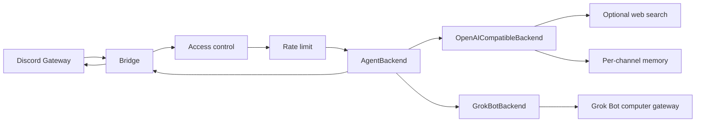

# discord-agent-bridge — Implementation Plan

## Goal

**Connect any Grok Bot to Discord** for personal or small-team use — a community Discord ↔ Grok Bot connector for people who work in Discord instead of Slack/Teams.

Use-case specificity (persona, tools, routines) belongs in the **Grok Bot**, not in this bridge. A gaming helper, team assistant, or personal agent are all valid; this repo stays use-case agnostic.

**Flow:** Discord message → bridge (auth + routing) → pluggable `AgentBackend` → reply in Discord.

## North Star

Ship a real `GrokBotBackend` once Grok Bot exposes a Discord/Channels-style inbound API. This repo is the community connector for that path.

**Phase 1** keeps `OpenAICompatibleBackend` as the default runnable path (xAI / OpenAI / OpenRouter chat completions). `GrokBotBackend` can optionally wake a Grok Bot agent via that computer's unofficial private HTTP gateway plus an authenticated bridge callback — not an official Discord/Channels API.

## Phase 1 scope

Always-on Node.js gateway bot (not Azure Functions / slash-commands-only). Pluggable backends; Phase 1 production path is OpenAI-compatible HTTP. Team-friendly access control: users, roles, guilds, free-response channels, optional DMs / DM-only mode.

### Stack

| Piece | Choice |
|-------|--------|
| Runtime | Node.js 20+, TypeScript ESM |
| Discord | discord.js v14 gateway (`GuildMessages` + `MessageContent`; `DirectMessages` when DMs enabled) |
| Tests | Vitest |
| Build | `tsc` → `dist/` |
| Ops | Dockerfile + docker-compose |
| CI | GitHub Actions: install → test → build |
| License | MIT |

### Architecture

### Modules

| Module | Responsibility |
|--------|----------------|
| `src/config.ts` | Parse/validate env; export typed config |
| `src/discord/access.ts` | User / role / guild / DM / mention / free-channel gates |
| `src/discord/rateLimit.ts` | Simple per-user sliding window |
| `src/discord/reply.ts` | Typing indicator, ~1900-char split, send |
| `src/discord/bot.ts` | Client, messageCreate handler, ignore bots/self |
| `src/agent/backend.ts` | `AgentBackend` interface |
| `src/agent/openaiCompatible.ts` | Phase 1 runnable: chat completions + memory + optional tools |
| `src/agent/grokBot.ts` | Unofficial computer-gateway client (`POST /api/sendPrompt`) + callback wait |
| `src/http/replyServer.ts` | Authenticated `POST /internal/reply` for the Grok Bot agent |
| `src/agent/memory.ts` | In-memory per-channel/thread history with length cap |
| `src/agent/tools/webSearch.ts` | Brave and/or Tavily if keys present |
| `src/index.ts` | Load config, pick backend, start bot |
| `SOUL.md` | Neutral default system prompt (swap via `SYSTEM_PROMPT_FILE` / examples) |

### Env vars

| Variable | Required | Notes |
|----------|----------|-------|
| `DISCORD_BOT_TOKEN` | yes | Bot token |
| `DISCORD_ALLOWED_ROLES` | no | Comma-separated role IDs; empty = no role gate |
| `DISCORD_ALLOW_ALL_USERS` | no | Default `false` |
| `DISCORD_ALLOWED_USERS` | no | Comma-separated user IDs |
| `DISCORD_ALLOWED_GUILDS` | no | Comma-separated guild IDs; empty = any guild |
| `DISCORD_ALLOW_DMS` | no | Default `false`; allow DM conversations with the bot |
| `DISCORD_DM_ONLY` | no | Default `false`; ignore all guild messages |
| `DISCORD_FREE_RESPONSE_CHANNELS` | no | Channel IDs: reply without @mention |
| `DISCORD_REQUIRE_MENTION` | no | Default `true` outside free-response channels (DMs never require mention) |
| `DISCORD_HOME_CHANNEL` | no | Optional home channel ID (logged / future routing) |
| `AGENT_BACKEND` | no | `openai` (default) \| `grok-bot` (unofficial gateway + callback) |
| `GROK_BOT_GATEWAY_URL` | if grok-bot | Private computer gateway base (do not expose `:1340` publicly). Colocated host process: `http://127.0.0.1:1340` |
| `GROK_BOT_TOKEN` | if grok-bot | Bearer from that computer's `gateway.json` |
| `GROK_BOT_AGENT_ID` | if grok-bot | Target agent id from `POST /api/listAgents` |
| `GROK_BOT_TIMEOUT_MS` | no | Default `120000` |
| `BRIDGE_HTTP_HOST` | no | Default `0.0.0.0`. Colocated host process: `127.0.0.1` |
| `BRIDGE_HTTP_PORT` | no | Default `8788` |
| `BRIDGE_PUBLIC_URL` | if grok-bot | Reachable from the Grok Bot computer. Colocated host process: `http://127.0.0.1:8788`. When the bridge runs on a different machine, that machine's `localhost` is not the bridge. |
| `BRIDGE_REPLY_TOKEN` | if grok-bot | Bearer for `POST /internal/reply` |
| `API_BASE_URL` | if openai | e.g. `https://api.x.ai/v1` |
| `API_KEY` | if openai | Provider API key |
| `MODEL` | if openai | Model id |
| `SYSTEM_PROMPT_FILE` | no | Default `SOUL.md` |
| `TEMPERATURE` | no | Default `0.7` |
| `MAX_TOKENS` | no | Default `1024` |
| `MEMORY_MAX_MESSAGES` | no | Default `20` |
| `RATE_LIMIT_PER_USER` | no | Default `5` messages / window |
| `RATE_LIMIT_WINDOW_MS` | no | Default `60000` |
| `BRAVE_API_KEY` | no | Enables Brave web search tool |
| `TAVILY_API_KEY` | no | Enables Tavily web search tool |

### Discord Developer Portal setup

1. Create application → Bot → copy token → `DISCORD_BOT_TOKEN`.
2. Privileged Gateway Intents: enable **Message Content Intent**. Phase 1 reads roles from `message.member` on guild messages.
3. OAuth2 URL Generator: scopes `bot`; permissions: View Channels, Send Messages, Read Message History, Add Reactions (optional).
4. Invite to a **private** test server (or use DMs with `DISCORD_ALLOW_DMS=true`) first. Do not make the bot public until access control is verified.
5. Never commit tokens; use `.env` locally / secrets in CI-deploy.

### Access control (team-friendly)

A message is handled only if:

1. Author is not a bot / not self.
2. **Channel kind:** if `DISCORD_DM_ONLY`, reject guild messages. If the message is a DM, require `DISCORD_ALLOW_DMS`. If guild and `DISCORD_ALLOWED_GUILDS` is non-empty, guild must be listed.
3. **Who:** if `DISCORD_ALLOW_ALL_USERS` is false, author must be in `DISCORD_ALLOWED_USERS` **or** (guild only, when roles are configured) hold at least one of `DISCORD_ALLOWED_ROLES`. If both user and role lists are empty and allow-all is false, nobody is allowed (fail closed). DMs use the user allowlist / allow-all only (no roles).
4. **Mention:** in guilds, bot must be @mentioned unless the channel is in `DISCORD_FREE_RESPONSE_CHANNELS`, or `DISCORD_REQUIRE_MENTION=false`. DMs never require an @mention.

### Reply UX

- Start typing indicator while the backend runs.
- Prefer short Discord-friendly answers (system prompt + max tokens).
- Split replies at ~1900 characters on paragraph/newline boundaries when possible.
- Per-user rate limit with a brief rejection message.

### Examples (persona lives outside the bridge)

| Path | Purpose |
|------|---------|
| `SOUL.md` | Neutral default |
| `examples/team-assistant/SOUL.md` | Small-team Discord assistant |
| `examples/gaming-helper/SOUL.md` | One domain example among many |

Point `SYSTEM_PROMPT_FILE` at an example, or replace with your Grok Bot’s own soul/instructions.

### Test plan

| Layer | Coverage |
|-------|----------|
| Unit | Config parsing; access control matrix (guild/DM/roles); message split; rate limit; memory cap; reply-endpoint auth; Grok Bot sendPrompt + callback / timeout |
| Manual | Invite bot → set allowlists → mention in free vs gated channels / DM → verify OpenAI-compatible reply |
| CI | `npm ci` → `npm test` → `npm run build` |

### Migrating from another Discord agent host

- Map allowlists → `DISCORD_ALLOWED_USERS` / `DISCORD_ALLOWED_ROLES` / `DISCORD_ALLOWED_GUILDS` / `DISCORD_FREE_RESPONSE_CHANNELS`.
- Point `SYSTEM_PROMPT_FILE` at your existing soul/instructions (or copy into `SOUL.md`). Do **not** copy proprietary host source into this repo.
- Point `API_BASE_URL` / `API_KEY` / `MODEL` at an OpenAI-compatible provider until `GrokBotBackend` is available.
- Run as a long-lived process (Docker / systemd / PM2). This is not an Azure Functions / reminder-bot pattern.

## Phase 1 non-goals

- No Azure Functions hosting
- No invented official Grok Bot Discord/Channels API (interim path is only `/api/sendPrompt` + bridge callback)
- No multi-tenant SaaS
- No use-case-specific product logic in the bridge (gaming, sales, etc. belong in the agent)

## Phase 2 notes

See [PHASE2-GROK-BOT-BACKEND.md](./PHASE2-GROK-BOT-BACKEND.md) for the interim unofficial computer-gateway + `/internal/reply` callback (2026-08-14). Official Discord Channels inbound API is still the North Star and may replace this.

- Keep `AgentBackend` as the seam. Do not expose the Grok Bot gateway port publicly.
- Possible later: persistent memory (SQLite/Redis), richer tool registry, slash commands as *supplement* to gateway, observability (structured logs / metrics).

## Implementation order

1. Plan (`docs/PLAN.md`) ← this file  
2. Package scaffold, license, gitignore, tsconfig  
3. Config + access + rate limit + split utilities + tests  
4. Agent backends + memory + optional web search  
5. Discord bot wiring + `index.ts`  
6. Neutral `SOUL.md`, examples, README, Docker, CI  
7. Verify `npm test` and `npm run build`
